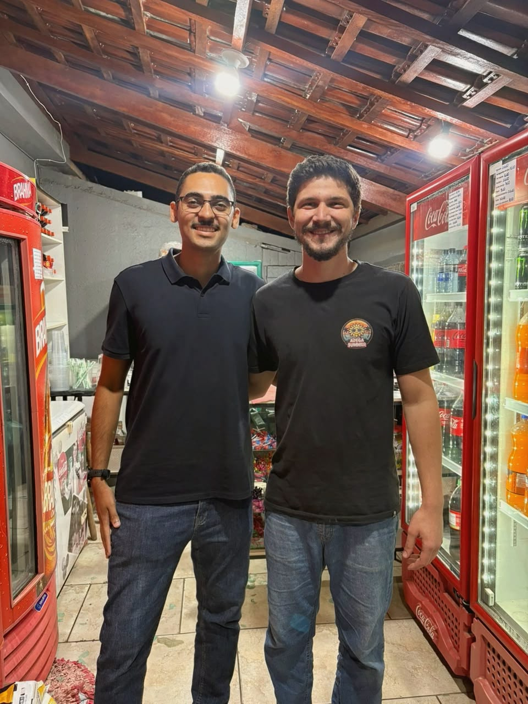

# Adega Summer

Sistema de gestão local desenvolvido para apoiar a operação de uma adega, reunindo vendas, estoque, controle de caixa e acompanhamento administrativo em uma única aplicação.

> Aplicação instalada no ambiente do cliente e executada após os ajustes de infraestrutura e instalação.

## Problema

A Adega Summer foi criada para organizar rotinas de vendas, estoque e controle de clientes e oferecer uma visão mais confiável da operação.

## Funcionalidades

- Registro de vendas e acompanhamento de caixa;
- Controle de estoque por produto, entradas e ajustes;
- Gestão de fiado, recebimentos, consumação e cancelamentos;
- Cadastro de produtos, categorias e marcas;
- Indicadores gerenciais, alertas e dashboard;
- Controle de acesso por perfil e auditoria de ações administrativas;
- Backup, restauração e diagnóstico operacional.

## Tecnologias

- **Backend:** Python e FastAPI
- **Frontend:** Next.js e TypeScript
- **Banco de dados:** PostgreSQL
- **Containerização:** Docker e Docker Compose
- **Testes de interface:** Playwright
- **Automação operacional:** PowerShell

## Desenvolvimento e qualidade

O desenvolvimento priorizou consistência de dados e segurança operacional em cenários com mais de um usuário. Foram realizadas validações de operações simultâneas, cancelamentos, idempotência, permissões, backup e restauração, recuperação de serviços, interface em desktop e mobile e carga com múltiplos usuários.

O estoque é centralizado por produto, com regras para evitar saldo negativo e inconsistências em vendas, consumação e cancelamentos.

## Instalação e entrega no cliente

A entrega envolveu adaptar a aplicação e seu ambiente de execução ao computador utilizado pela equipe da Adega Summer. O estabelecimento tem uma rotina intensa de vendas, tornando a organização das operações e o funcionamento dos sistemas importantes para o atendimento diário.

O proprietário, Átila, confiou no meu trabalho para desenvolver e instalar a solução. Durante a visita, além de instalar a aplicação, acompanhei a preparação do computador para que ele estivesse em condições de executá-la.

*Registro com Átila na Adega Summer após a instalação.*

### Preparação do ambiente

- Avaliei o computador que receberia a aplicação e os recursos disponíveis para executar os serviços em Docker.
- A máquina tinha 8 GB de memória RAM. Na minha avaliação técnica, ampliar a memória ajudaria a preparar o ambiente; instalamos um módulo adicional de 16 GB.
- Durante a instalação, encontrei problemas relacionados ao WSL. Investiguei o ambiente e realizei atualizações e ajustes necessários para executar a solução.
- Após os ajustes, concluí a instalação e confirmei que o sistema estava funcionando naquele momento.

A ampliação de memória foi uma decisão para aquele equipamento e cenário; os problemas encontrados no WSL não foram atribuídos a uma causa específica.

### Apoio após a instalação

Ao final do dia, por volta da meia-noite, Átila entrou em contato porque a aplicação NFC-e/DataCamp, utilizada pelo estabelecimento para emissão de notas, havia parado de funcionar. Na análise, identifiquei que a base de dados local estava indisponível porque os serviços do Firebird estavam parados:

- **Firebird Guardian - DefaultInstance:** parado, embora configurado para inicialização automática.
- **Firebird Server - DefaultInstance:** parado e configurado para inicialização manual.

Ao iniciar o serviço `FirebirdGuardianDefaultInstance`, os dois serviços voltaram a ficar ativos e a aplicação pôde acessar novamente a base local. Após o atendimento, os sistemas estavam funcionando.

Essa experiência reforçou a importância de acompanhar a entrega no ambiente real, investigar dificuldades de infraestrutura e apoiar a continuidade da operação do cliente. O atendimento ao Datacamp foi uma demanda adicional à instalação da aplicação desenvolvida para a Adega Summer.

## Status

A aplicação foi instalada no computador do cliente e funcionou após os ajustes de ambiente. A experiência descrita registra a entrega e a verificação naquele momento; não apresenta métricas de disponibilidade ou resultados de operação contínua.

Projeto de engenharia de software desenvolvido para atender às necessidades de um negócio real, com foco em consistência de dados, manutenção e confiabilidade operacional.
