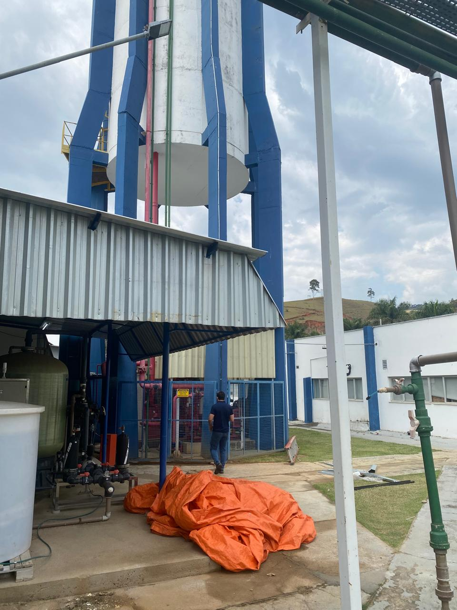
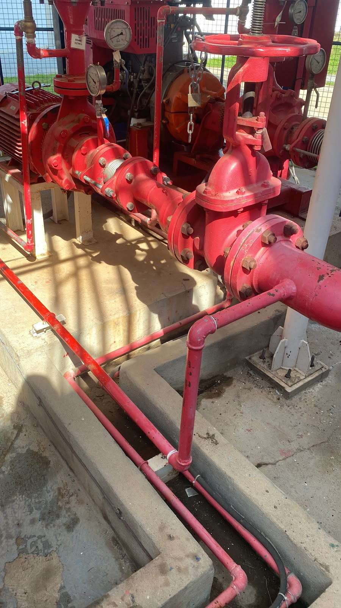

# Automação e Supervisão de Sistemas de Pressurização e Combate a Incêndio

Solução de software voltada à supervisão de variáveis operacionais, ao acompanhamento de equipamentos e ao apoio a rotinas de teste em sistemas de pressurização e combate a incêndio.

## Contexto

O acompanhamento de sistemas de combate a incêndio envolve a verificação de condições como pressão hidráulica, nível de reservatório, disponibilidade de energia e estado dos equipamentos.

O projeto foi desenvolvido para centralizar informações de supervisão, registrar eventos e apoiar a execução de testes, oferecendo à equipe uma visão mais organizada da operação e de seu histórico.

A solução já funciona em várias empresas. Sua utilização depende das características de cada instalação e da atuação dos profissionais responsáveis pelo sistema.

## Estrutura física e responsabilidade técnica

As imagens mostram uma instalação relacionada ao projeto e ajudam a visualizar a escala do ambiente supervisionado: um reservatório com mais de 10 metros de altura e um conjunto de bombas que podem operar simultaneamente. São equipamentos vinculados a um sistema de proteção contra incêndio, em que a supervisão, o registro de eventos e os comandos de teste exigem cuidado com as condições reais de operação.

*Reservatório elevado e estrutura da instalação.*

*Conjunto de bombas e tubulações do sistema.*

O desenvolvimento do software envolve interpretar requisitos de engenharia, acompanhar condições e estados dos equipamentos e validar a integração com os responsáveis técnicos. As imagens ilustram o contexto físico; por si só, não demonstram o funcionamento ou a validação de uma instalação específica.

## Visão geral da solução

A aplicação reúne interface web, backend, banco de dados e integração com uma camada de automação industrial. Entre suas funcionalidades estão:

- Acompanhamento de variáveis e estados operacionais;
- Visualização de condições e histórico de eventos;
- Apoio a rotinas de teste manual e agendado, conforme a configuração da instalação;
- Envio de comandos temporários necessários às rotinas de teste;
- Registro de eventos e alarmes;
- Geração de relatórios e apoio ao envio de notificações por e-mail.

A solução atua em conjunto com os equipamentos e procedimentos da instalação. Sua aplicação não substitui inspeções obrigatórias nem a atuação dos responsáveis técnicos.

## Minha contribuição

O trabalho que desenvolvi no projeto incluiu:

- Desenvolvimento de funcionalidades da aplicação de supervisão e da interface web;
- Implementação de serviços backend para leitura de variáveis e registro de informações;
- Desenvolvimento da integração entre a aplicação e a camada de automação industrial;
- Implementação de rotinas para acompanhamento e execução de testes;
- Criação de um simulador local para apoiar a validação da comunicação industrial;
- Preparação de documentação e participação nas atividades de validação técnica.

O projeto foi desenvolvido em conjunto com o projetista **Michael Richard**.

## Tecnologias

| Tecnologia | Aplicação no projeto |
| --- | --- |
| Java 17 e Spring Boot | Backend, regras de negócio e serviços web |
| PostgreSQL e Flyway | Persistência de dados e evolução do banco |
| HTML, CSS e JavaScript | Interface web |
| WebSocket | Atualização de informações operacionais na interface |
| Modbus TCP | Comunicação com a camada de automação industrial |
| Python e Tkinter | Simulador local |
| Gradle | Build e gerenciamento de dependências |
| SMTP | Notificações e envio de relatórios por e-mail |

## Arquitetura em alto nível

A solução integra informações da instalação industrial ao backend de supervisão. A aplicação disponibiliza informações na interface web e mantém registros para consulta e geração de relatórios. A separação entre a camada industrial e a aplicação permite organizar a integração de acordo com as características de cada instalação.

## Testes e validação

Em ambiente local, foram realizados:

- Compilação e execução do backend e da interface;
- Migrações do banco de dados em ambiente isolado;
- Validação da comunicação TCP com o simulador industrial;
- Uso do simulador para apoiar a avaliação de cenários operacionais e comandos de teste.

Os testes com simulador ajudam a verificar a comunicação e o comportamento da aplicação em laboratório. A integração com equipamentos reais deve ser avaliada de acordo com as condições e os procedimentos de cada instalação.

## Casos técnicos de validação

### Divergência entre pressão física e telemetria

Durante a validação de uma instalação, identifiquei uma diferença entre a pressão indicada no instrumento físico e o valor mostrado pela aplicação. Investiguei o caminho do dado desde o sensor até a interface, comparando a referência física com os dados recebidos nas etapas de integração e supervisão.

A divergência já estava presente na entrada da camada de automação e foi direcionada ao sensor de pressão. O caso destacou a importância de rastrear o sinal entre campo, integração e aplicação antes de atribuir a inconsistência ao software.

### Confirmação de estados entre etapas de teste

Em testes de sequência, observei uma transição em que uma bomba poderia iniciar antes da confirmação de desligamento da anterior. Para evitar que uma solicitação de comando fosse tratada como confirmação de uma mudança física, trabalhei na validação do retorno do equipamento antes da liberação da etapa seguinte.

A lógica considera a validade e atualidade da informação e prevê o bloqueio da sequência e o registro de ocorrência quando a confirmação esperada não chega. O caso reforçou a importância de verificar o retorno do campo em sistemas de automação que interagem com equipamentos físicos.

## Situação atual

A solução está em funcionamento em várias empresas e apoia atividades de acompanhamento e teste dos sistemas instalados.

O projeto proporcionou experiência prática em desenvolvimento backend, integração industrial, persistência de dados, testes e tradução de requisitos de engenharia em software.
